# Global Trade OS

**One trusted digital environment for discovering, qualifying, negotiating, coordinating, and growing international trade relationships.**

> **Status: Demo / Prototype.** This is a portfolio-grade frontend demo, not a live product. There is no backend, no real verification provider, no real payment processor, no real AI integration, and no real customer data anywhere in this repository. Every company, transaction, quotation, representative, and commission figure shown in the UI is synthetic and clearly labelled. See [`docs/DEMO.md`](docs/DEMO.md) for the full real-vs-simulated inventory.

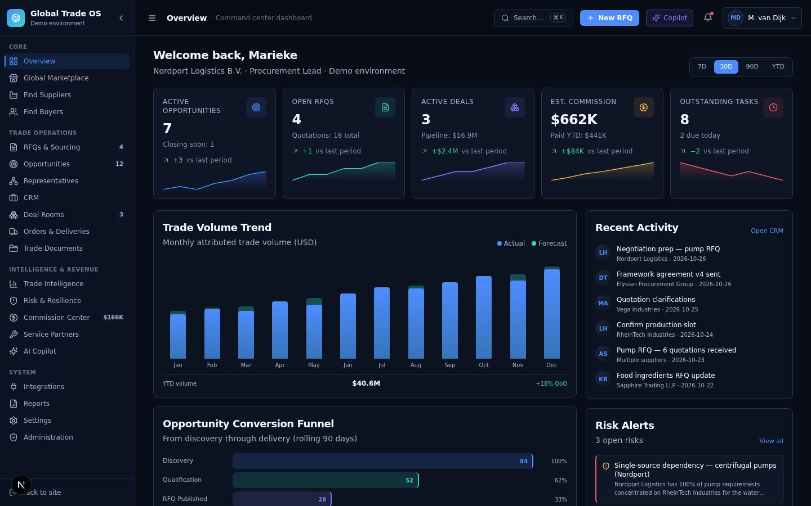

## Problem

International B2B trade today is fragmented across disconnected tools: marketplaces that don't carry transaction history, ERPs that don't reach beyond one company's walls, CRMs that lose context the moment a deal crosses borders, and verification services that produce PDFs no one can act on programmatically. Sourcing managers, supplier sales teams, and country representatives juggle spreadsheets, email threads, and ad-hoc introductions — with no shared source of truth for what was checked, who owns which opportunity, and what commission is owed to whom.

## Solution

Global Trade OS combines a verified B2B marketplace, an explainable AI-powered matching engine, a managed country representative network, an immutable commission ledger, and secure digital deal rooms into one operating system. Every consequential action — publishing an RFQ, shortlisting a supplier, approving a commission payout — happens inside a single auditable workflow, with self-reported information always distinguished from verified facts.

## Features (built in this demo)

- **Premium public landing page** — hero, 20-module product grid, 4-step workflow, buyer/supplier/representative personas, AI Copilot demo dialogue, Trade Passport preview, 4-tier pricing, FAQ.
- **Application shell** — collapsible sidebar with 19 nav items grouped (Core / Trade Operations / Intelligence & Revenue / System), topbar with global search and notifications, **⌘K command palette** with fuzzy search across all entities.
- **Overview dashboard** — 5 KPI cards with sparklines, trade volume bar chart, opportunity conversion funnel, active opportunities, recent activity feed, risk alerts, representative network, upcoming deliveries, AI suggestion banner.
- **Global marketplace** — 8 trade opportunity cards (Buy RFQ, Supply Offer, Distribution, Capacity, Contract Manufacturing) with type/category/country filters, confidentiality badges, full spec grids.
- **Verified company directories** — Find Suppliers + Find Buyers with 10 fictional international companies, sortable, deep Trade Passport profile pages (verification checks, certifications, capabilities, commercial terms).
- **RFQ & sourcing workflow** — 4 RFQs with line items, evaluation criteria, full timelines; RFQ detail view with quotations comparison (match score radial, weighted criteria, explainable match reasons).
- **Representative network** — 6 country reps across DE / NL / SG / US / AE / UK with agreement types, territory coverage, commission pipeline per rep.
- **Commission center** — pipeline visualization (Estimated → Earned → Approved → Payable → Paid), 7 agreements, 12 immutable ledger entries including a reversal.
- **AI Sourcing Copilot** — interactive chat with structured response blocks (RFQ draft, supplier match, clarification, next-action, warning), 12 specialized agents sidebar, human-in-the-loop safety panel.
- **Deal rooms, CRM, orders, documents, intelligence, risk, service partners, integrations, reports, settings, admin** — 12 more views, all wired to deterministic demo data with working filters, sorting, and empty states.
- **Forced dark theme** — premium palette (`#080D18` background, `#4D8DFF` primary, `#35D6C5` accent, `#8B7BFF` violet for AI) validated for contrast, with custom SVG sparklines (no chart library).

## Screenshots

| Landing page (hero) | Full landing page |
|---|---|
| 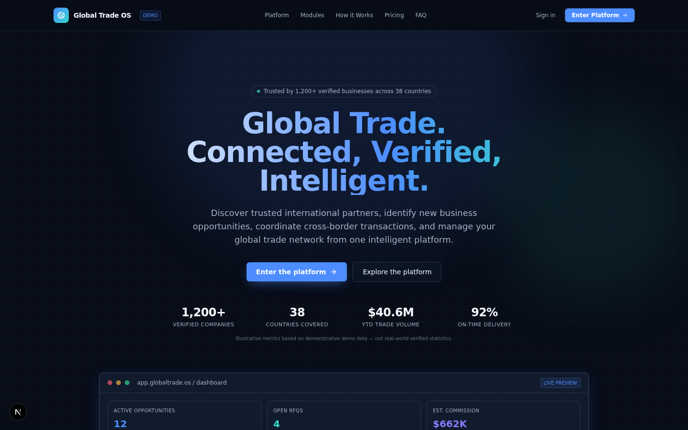 | 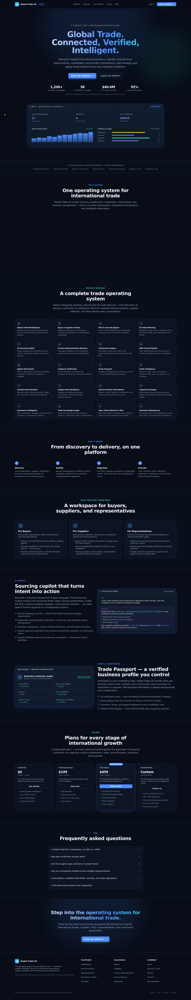 |

| **Overview dashboard** | **AI Sourcing Copilot** |
|---|---|
|  |  |

| **Global Marketplace** | **Trade Intelligence** |
|---|---|
| 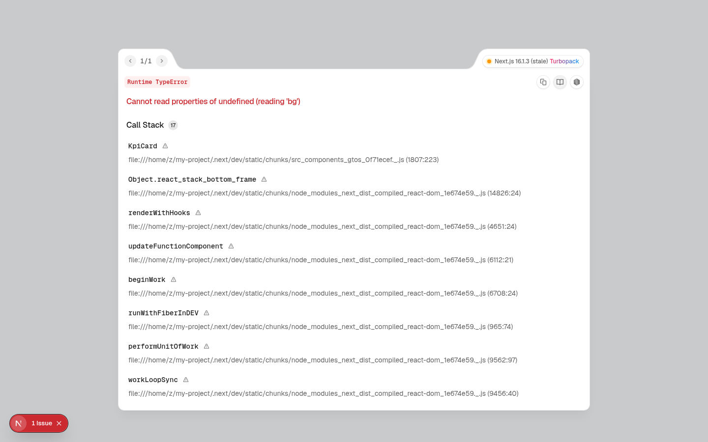 | 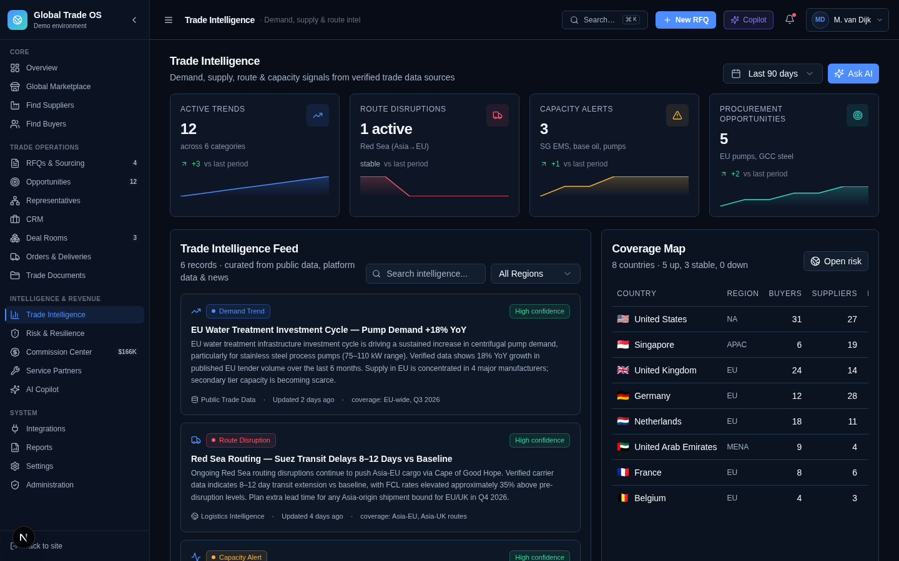 |

| **Risk & Resilience** | **Orders & Deliveries** |
|---|---|
| 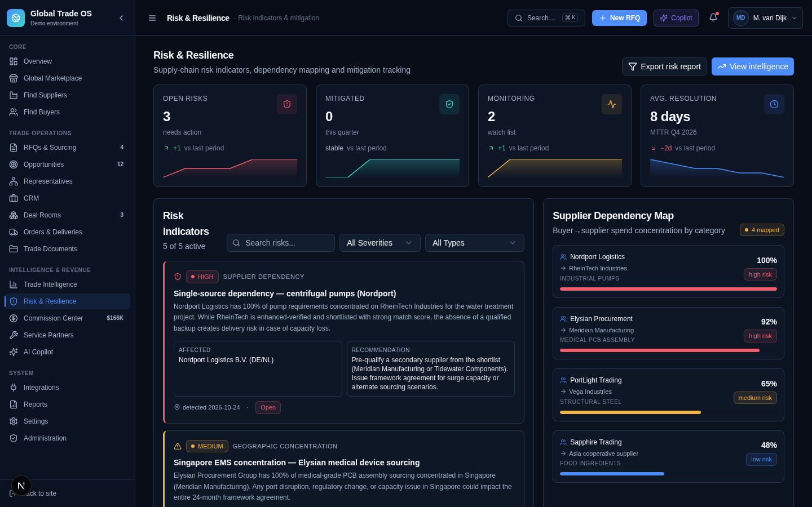 | 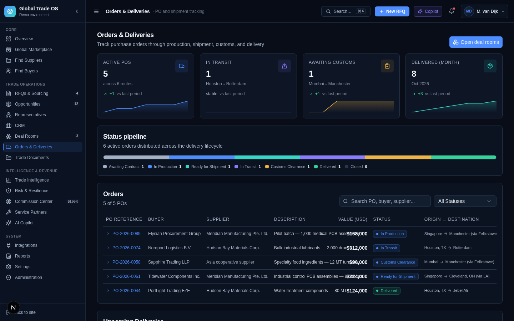 |

| **Integrations** | **Settings** |
|---|---|
| 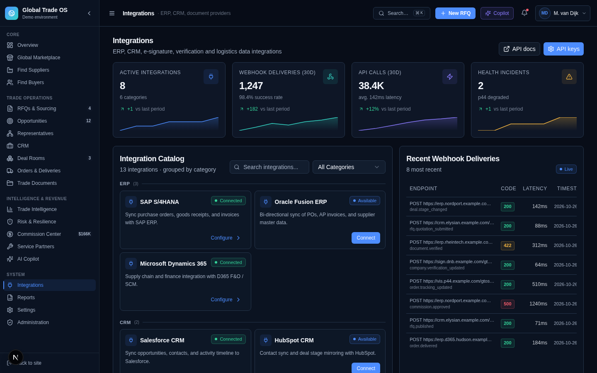 | 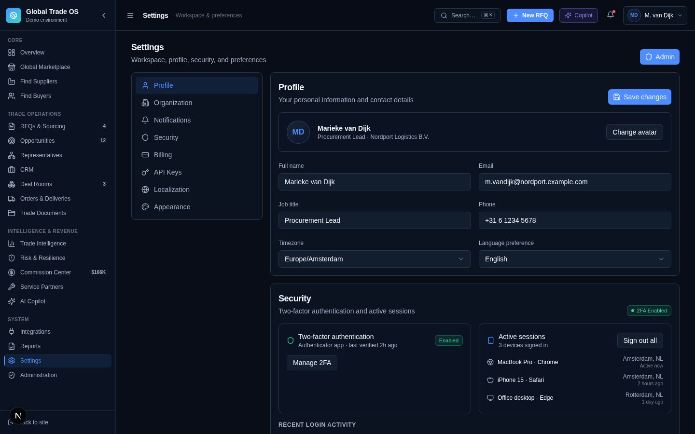 |

| **Administration** | **AI Copilot — full view** |
|---|---|
| 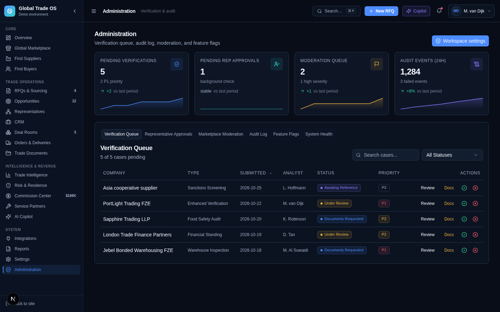 | 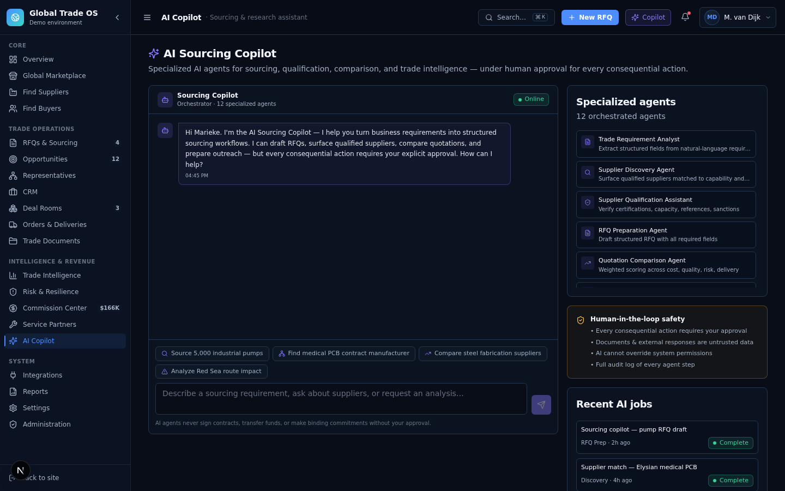 |

_Captured at 1440×900 viewport from the demo running locally. Every company, transaction, and commission figure is synthetic — the "Demo environment" label in the sidebar and the "Illustrative metrics based on demonstrative demo data" disclaimer under trust stats say so. The UI is dark-mode only by design; see [`docs/DECISIONS.md`](docs/DECISIONS.md)._

## Architecture

A single Next.js 16 (App Router, React 19, TypeScript, Tailwind v4) frontend rendering from in-repo mock data — no backend, no database writes, no real AI provider. State lives in a Zustand store that switches between the public landing page and the authenticated application shell, with Framer Motion's `AnimatePresence` handling view transitions. Full target-state architecture (what a real backend, verification provider, and LLM integration would look like, and exactly where they would plug in) is documented in [`docs/ARCHITECTURE.md`](docs/ARCHITECTURE.md).

## Tech stack

Next.js 16 · React 19 · TypeScript · Tailwind CSS v4 · shadcn/ui (New York) · Framer Motion · Zustand · Lucide icons · hand-built SVG charts (no charting library) · Geist Sans/Mono fonts.

## Demo instructions

```bash
git clone https://github.com/adelakbaribiz-sketch/global-trade-os.git
cd global-trade-os
bun install     # or npm install
bun run dev     # or npm run dev
```

Open the printed local URL (default `http://localhost:3000`). Click **"Enter Platform"** on the landing page to access the application shell. Press **⌘K** (Mac) or **Ctrl+K** (Windows/Linux) anywhere in the app to open the command palette. Full walkthrough in [`docs/DEMO.md`](docs/DEMO.md).

## Installation / environment variables

No environment variables are required — the app runs entirely on in-repo mock data in `src/lib/data/`. The Prisma schema in `prisma/schema.prisma` is included for future backend work but is unused in the demo. See [`docs/DEPLOYMENT.md`](docs/DEPLOYMENT.md) for production build and deployment notes.

## Project structure

```
global-trade-os/
├── src/
│   ├── app/                        Next.js App Router (single route — switches Landing ↔ AppShell)
│   │   ├── globals.css             Premium dark theme tokens
│   │   ├── layout.tsx              Root layout, forced dark mode
│   │   └── page.tsx                Single route — view switching via Zustand
│   ├── components/
│   │   ├── ui/                     shadcn/ui primitives (40+ components)
│   │   └── gtos/
│   │       ├── landing/            Public website
│   │       ├── shell/              AppShell, Sidebar, Topbar, CommandPalette
│   │       ├── shared/             KpiCard, StatusBadge, Primitives, PageContainer
│   │       └── views/              20 view components
│   └── lib/
│       ├── store/                  Zustand store (view, detailId, command palette)
│       └── data/                   8 deterministic demo data modules
├── docs/                           full documentation suite (see below)
│   └── screenshots/                7 platform screenshots
├── prisma/schema.prisma            default schema (unused in demo)
├── public/                         logo, robots.txt
├── README.md                       this file
└── CHANGELOG.md
```

## Documentation

| Doc | What it covers |
|---|---|
| [PROJECT_CONTEXT.md](docs/PROJECT_CONTEXT.md) | What stage this is at and why it's built this way |
| [PRODUCT_REQUIREMENTS.md](docs/PRODUCT_REQUIREMENTS.md) | Feature-by-feature: demo scope vs. real-system scope |
| [ARCHITECTURE.md](docs/ARCHITECTURE.md) | What's running vs. target architecture |
| [USER_FLOWS.md](docs/USER_FLOWS.md) | Every flow, built or spec'd |
| [API_SPEC.md](docs/API_SPEC.md) | The Open Trade Network API surface the demo imitates |
| [DATA_MODEL.md](docs/DATA_MODEL.md) | Current mock-data shapes + real-schema open questions |
| [SECURITY.md](docs/SECURITY.md) | What was checked, what's out of scope |
| [DECISIONS.md](docs/DECISIONS.md) | Every engineering decision made, and why |
| [ROADMAP.md](docs/ROADMAP.md) | What's next, in order |
| [DEMO.md](docs/DEMO.md) | Full real-vs-simulated inventory + walkthrough |
| [DEPLOYMENT.md](docs/DEPLOYMENT.md) | How to run/build/deploy |
| [TESTING.md](docs/TESTING.md) | What was actually tested, PASSED/FIXED/REMAINING |
| [LIMITATIONS.md](docs/LIMITATIONS.md) | Every open gap — read this first |
| [DESIGN_SYSTEM.md](docs/DESIGN_SYSTEM.md) | Color palette, typography, spacing, component patterns |
| [MODULE_MATRIX.md](docs/MODULE_MATRIX.md) | Implementation status of all 20 modules |
| [SETUP.md](docs/SETUP.md) | Installation, troubleshooting, demo credentials |

## Business & product overview

- **Target customer:** multinational procurement organisations, export-oriented manufacturers, contract manufacturing partners, country representatives, and trade service providers (freight forwarders, inspection companies, customs brokers) who need to coordinate cross-border deals through a single trusted environment.
- **Differentiation:** unifies verified B2B discovery, structured RFQ workflow, explainable AI matching, representative attribution, and an immutable commission ledger into one operating system — rather than treating these as separate tools (marketplaces, CRMs, ERPs, spreadsheet commission trackers).
- **Monetization (proposed, unvalidated):** transaction commissions on awarded contracts, enterprise subscriptions (Starter / Professional / Business / Enterprise tiers shown in the demo), representative network subscriptions, advanced sourcing subscriptions, and API access fees. No pricing has been tested with a real customer.
- **Current stage:** demo/prototype. No revenue, no users, no funding, no real integrations.

## Limitations

See [`docs/LIMITATIONS.md`](docs/LIMITATIONS.md) for the full list. Highlights: no backend persistence (Zustand-only state), no real authentication, no real AI provider (Copilot uses a rule-based reply generator), no real e-signature / payment / verification integrations, no real sanctions screening, all commission figures are illustrative demo data, and the dev server (Turbopack) can be unstable in some sandboxed environments — see [`docs/TESTING.md`](docs/TESTING.md).

## Portfolio case study

**What I built:** a demo-grade product experience for an international trade operating system concept originally scoped as a master prompt — taken from an unstructured brief to a navigable, responsive, professionally-designed frontend with 20 integrated modules and an honest documentation suite.

**Problem:** the source material was a 23-section master prompt specifying a "world-class global trade operating system" with 21 modules, an AI agent architecture, a commission ledger, and a representative network — but no code, no design system, and no concrete implementation. The task was to turn it into something a reviewer could actually evaluate — without fabricating the parts that weren't real (verified companies, completed transactions, paid commissions, real AI integrations).

**Approach:** classified the project (enterprise SaaS + B2B marketplace, international trade sub-domain), ran a gap analysis against the master prompt, then built "maximum credible frontend, minimum necessary backend" — a fully click-through UI on clearly-labelled synthetic data across 20 modules, with architecture and API specs documented as target-state designs rather than pretending they're implemented.

**Key design decision:** a custom "Premium Dark Trade Surface" visual identity (deep charcoal `#080D18` background, electric-blue `#4D8DFF` primary, cyan `#35D6C5` accent, violet `#8B7BFF` for AI) built with hand-coded CSS variables in `globals.css` and validated against the prompt's specified palette — rather than a generic AI-dashboard template. All charts (sparklines, bar charts, conversion funnels) are hand-built SVG with no charting library, keeping the bundle small and giving precise visual control.

**Challenges:** keeping every simulated interaction (RFQ publication, quotation comparison, commission approval, AI Copilot drafting) honest about what it actually is, without undermining how the product *feels* to use — solved with a consistent "Demo environment" label in the sidebar, an "Illustrative metrics" disclaimer under every trust stat, and a human-in-the-loop safety panel on the AI Copilot that makes approval gates visible rather than hidden.

**Current status:** Demo / Prototype (see status block at the top of this file).

**Limitations & future roadmap:** see [`docs/LIMITATIONS.md`](docs/LIMITATIONS.md) and [`docs/ROADMAP.md`](docs/ROADMAP.md).

## License

[MIT](LICENSE) — for the code in this repository. This does not imply any claim over the "Global Trade OS" name or concept being available for unrestricted commercial use by others; see [LICENSE](LICENSE) for the actual terms.
